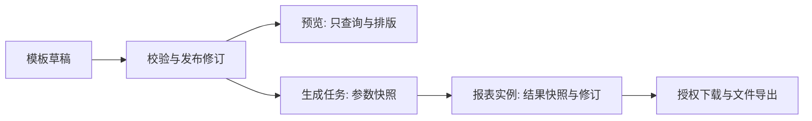

# 从报表 SDK 到产品能力

MachReport 同时提供浏览器预览、设计工具和无框架的 Node 执行能力。业务服务负责可信数据、存储与授权；报表结构、参数校验、计算、排版和输出复用同一套包。Java 等后端可通过 [Java → Node HTTP 参考](../examples/server-java-node/README.md) 调用，不必重新实现计算规则。

## 本轮可用能力

| 能力 | 已实现 | 接入责任 |
| --- | --- | --- |
| 查询参数 | 可视化设计；文本、数值、日期、月份、年份、日期区间、静态选择；共用校验和 JSON Schema | 把规范字符串映射为业务查询条件；白名单与数据权限仍在后端 |
| Excel 多区域 | 一张 Sheet 绑定多个单记录/纵向明细数据集；保留静态邻格；区域随行数下移；真实 XLSX 回读 | 提供具名数据集和稳定业务键；不能把模板样例当作查询结果 |
| 树形报表 | flat/nested 输入；稳定节点身份；显式父级来源值或叶子汇总；分页与输出统一 | 确定业务根、父子关系和合计口径 |
| 模板库 | 可分页搜索/分类/标签、打开、复制；复制清除原修订；复用草稿/发布 CAS | 提供 `ReportTemplateCatalogProvider` 与模板存储；本地目录不是企业模板服务 |
| 批量生成 | 多组参数预检、有界并发、逐行结果、取消、显式失败重试 | `execute` 调用同一个生成服务；返回小回执，文件存对象存储 |
| 报表实例 | 明确生成/保存，追加不可变修订，CAS 防覆盖；保存参数、模板/数据修订和渲染快照 | 实现 `ReportInstanceStore` 的持久事务；建立保留/归档策略与实例授权 |
| 后台执行 | Runtime 预算、Worker、持久任务租约与 attempt 围栏、取消和输出能力诊断 | 选择线程/进程部署和持久任务适配器；不自动提供计划调度 |

可运行示例：`pnpm --filter @agile-team/example-minimal dev` 后访问 `/platform.html`。它使用合成数据和有界内存存储，演示模板库 → 设计/发布 → 多参数生成 → 实例快照 → 导出。刷新清空，不代表生产持久化已经部署。

## 三种生命周期



- **模板**决定结构、参数、字段和计算；发布后按修订引用。
- **任务**记录执行状态/租约/进度，可超时、失败或重试；不等同于归档报表。
- **实例**记录一次生成的结果。再次查询可能得到不同实绩，查看旧实例应读取旧快照。预览不会调用保存；覆盖由 `expectedRevision` 明确控制；修改实例不会自动调用业务 `Provider.save`。

`createReportGenerationService` 绑定一份 Runtime 及它对应的模板修订映射。模板发布后重建这一注册快照，不要运行中修改其模板对象、再给它沿用旧修订号。数据来源修订来自同一次取数的 `revision`。未声明数据修订时不能声称数据可追溯到数据库历史版本。

```ts
import {
  createReportGenerationService, createMemoryReportInstanceStore,
  runReportBatch,
} from '@agile-team/mach-report/server';

const service = createReportGenerationService({
  runtime, // 与下面修订映射对应的不可变模板注册快照
  instances: createMemoryReportInstanceStore(), // 本地参考；生产替换为持久 CAS
  templateRevisions: { daily: publishedTemplate.revision },
});
const results = await runReportBatch(cases, async (item, { signal }) => {
  const saved = await service.generate({
    scope: trustedScope, id: item.id, title: '日报',
    reportIds: ['daily'], params: item.params,
    expectedRevision: null, signal,
  });
  return { instanceId: saved.id, revision: saved.revision };
}, { concurrency: 2, signal, onProgress });
```

`scope` 必须来自服务端可信上下文；它是隔离键，不是身份认证机制。新实例 `expectedRevision:null`，再次生成同 ID 会冲突；更新时提交刚读取的修订号。它防止意外覆盖，不提供跨进程的“生成只执行一次”：若需幂等执行，将稳定 request ID 交给已有持久任务服务，再在完成阶段追加实例。

## 持久化适配器验收

`ReportInstanceStore.compareAndSwap` 应在**一个事务**里比较当前修订、插入历史快照、推进当前指针。唯一键至少包含 `(scope, id, revision)`，当前指针包含 `(scope,id)`；禁止先读后无条件覆盖。`read` 返回独立快照，`list` 按 ID 稳定分页，只返回摘要，不读全部文件或历史。模板 CAS 与任务租约已有独立契约，应沿用而非混入一张状态表。

实例可存 JSON 快照 + 私有对象存储文件引用；不要存可执行函数、登录 token 或长期公开下载 URL。`artifacts` 只存 key/format/bytes/可选 SHA256；宿主在下载时重新授权并签发短期 URL。大实例可把内容分离存储，但原子提交、校验、保留和删除对象文件的责任不变。内存参考存储默认 100 实例、每实例 20 修订、总 64 MB、单快照 8 MB，达到预算会明确拒绝，不偷偷删除历史。调整单条快照上限时，存储器与管理器/生成服务的 `maxSnapshotBytes` 需显式配置一致；不能仅扩大一侧预算。

上线前至少验证：并发同修订仅一个成功、失败不留半条历史、实例/模板/任务租约三者隔离、进程重启可读、查询/导出/下载权限一致、跨范围不能访问、真实 0/空值/高精度不变、保留清理不破坏引用。当前没有为业务数据库执行任何迁移。

## 暂缓的后端平台能力

以下保留为产品路线与契约要求，**本轮不实现连接管理、企业账号权限、调度平台或机器人渠道**。没有对应的“已生效”控制台按钮。

| 模块 | 未来职责与必要契约 | 必须闭环的验收 |
| --- | --- | --- |
| 数据库/API 连接管理 | 服务端连接注册、租户绑定、凭据引用/轮换、连接测试、查询超时/限流、只读账号；JDBC/驱动和参数白名单；模板只引用 connectionId，不持有凭据 | 浏览器/模板无密钥；SQL 参数化；网络/表/列授权；连接池回收；敏感错误脱敏；连接失败可定位且不变成通用“系统错误” |
| 企业账号、租户与数据权限 | 复用现有 IAM，不再造账号库；模板发布/实例编辑/查询/导出/下载独立授权；审计 actor/tenant/action/revision/requestId；后台服务身份 | URL、队列、对象存储不能绕过授权；跨租户拒绝；授权撤销立即生效；审批/发布权限与草稿隔离 |
| 调度平台 | 计划定义与版本；时区/日历/相对日期解析；触发记录与稳定幂等键；错过触发策略；禁用/暂停；并发限制；服务身份入队 | 夏令时/跨日/月底/闰年；停机补偿；多实例不重复触发；取消围栏；失败恢复；计划版本与实际参数可追溯 |
| 机器人/邮件/Webhook 渠道 | 渠道注册与凭据引用；内容/附件适配；deliveryId、超时、限流、重试/死信；投递记录；敏感信息策略 | 重复回执不重复发；可取消/追踪；接收人和文件下载权限一致；秘钥不入模板；失败可重放并避免外发重复 |

依赖顺序：可信身份/范围 → 模板与实例持久化 → 数据连接与查询授权 → 调度触发 → 投递。调度层只解析参数和提交已有任务，不能复制报表引擎；投递层只消费已验收产物，不能顺手重查数据。相对日期应在一次触发开始时固定，并存解析后的绝对参数；无人值守任务使用受控服务身份，不能保存某个用户的 Bearer token 长期复用。

未来接口至少覆盖 `connections`、`catalog`、`templates/{id}/versions`、`jobs`、`instances/{id}/revisions`、`schedules`、`deliveries`。发布前需补 OpenAPI、错误码、迁移/回滚、幂等与审计契约、端到端负例和真实环境验收；这些尚未实现，不能把类型定义当上线闭环。

## 如何借鉴现有平台

操作手册中的分类、个人模板/公共模板、区域数据源绑定、参数批量生成、实例编辑/保存值得吸收。现有 `wl-report` 可提供连接、IAM、调度或投递服务，但要先核对实际接口、错误语义与权限，不假设已有截图代表后端联通。

Univer 工作簿、旧插件模板和 MachReport JSON 不是同一种格式；兼容应通过显式转换器和样例验收。我们保留完整宽表、毫米/A3/A4 选配和稳定业务身份，避免把重型在线电子表格、Excel 宏或企业平台依赖塞入常规预览入口。嵌入场景继续只需模板、Provider 和少量声明配置。

参见：[参数](PARAMETERS.md) · [Excel 绑定](EXCEL_BINDING.md) · [复杂报表](COMPLEX_REPORTS.md) · [批量生成](BATCH_GENERATION.md) · [设计器](DESIGNER.md) · [服务端](SERVER.md)。
